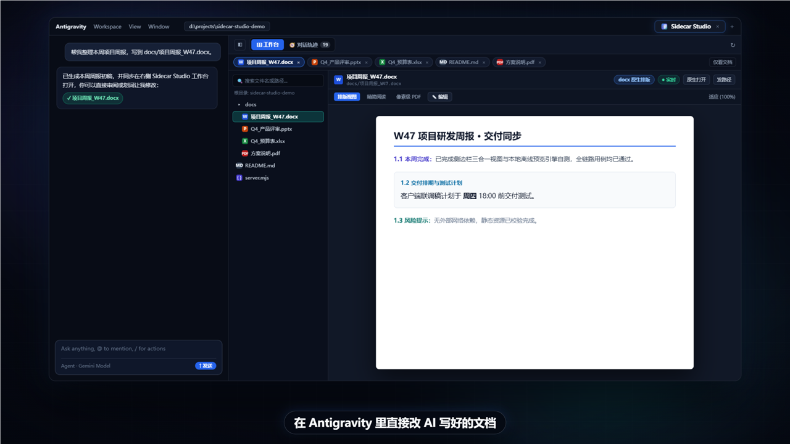
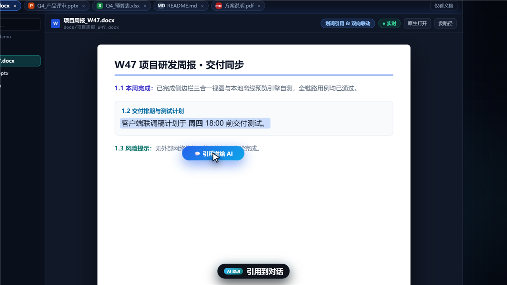
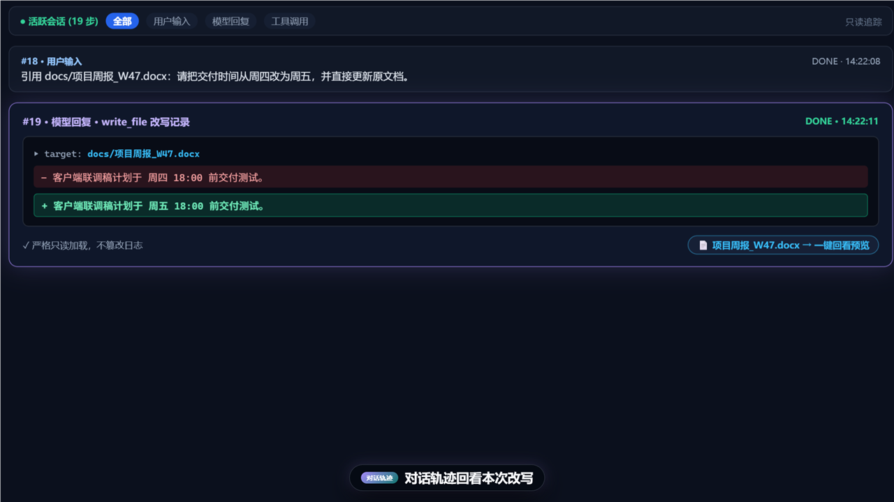

<div align="center">
  
  <h1>Sidecar Studio</h1>
  <p><strong>把整个文档工作台装进 Google Antigravity 全局侧边栏</strong></p>
  <p>
    <a href="https://github.com/burnerous/antigravity-sidecar-studio/releases/latest">
      
    </a>
    <a href="./LICENSE">
      
    </a>
    = 20" />
    
  </p>
</div>

> **English Summary**: **Sidecar Studio (`antigravity-sidecar-studio`)** is an offline-first auxiliary pane plugin for **Google Antigravity** (`SIDECAR_UI_ENTRYPOINT_AUX_PANE`). It combines a live **Workspace File Tree**, high-fidelity **Word / Excel / PPT / PDF / Markdown** preview & in-place editing (with instant quote-to-AI feedback and <2s auto-refresh), and a strict read-only **Conversation Trajectory Inspector** inside one unified dark-aurora sidebar. Jump directly to [Quick Start (Offline Zip / Source)](#-快速安装quick-start) or download the ready-to-use package from [GitHub Releases](https://github.com/burnerous/antigravity-sidecar-studio/releases/latest).

> 🎬 **演示视频**：[Antigravity侧边栏增强插件「Sidecar Studio」：告别繁琐的切屏，在侧边栏预览修改word、Excel、ppt！](https://www.bilibili.com/video/BV1SWyhzAE55/)（Bilibili · `BV1SWyhzAE55` · UP 主 **`Lu0H1N`**）

---

## ✨ 界面预览

| 三合一工作台（对话 + 文件树 + 文档） | 划词 / 选表直接引用发给 AI | 只读对话轨迹 & 改写 Diff 溯源 |
| :---: | :---: | :---: |
|  |  |  |

---

## 📦 快速安装（Quick Start）

### 前置条件

- **Node.js `>= 20.0.0`**（推荐 `>= 22`，可在终端运行 `node -v` 查看）
- **Google Antigravity IDE**（支持 `plugin.json` + `SIDECAR_UI_ENTRYPOINT_AUX_PANE` 的版本）

---

### 方式一：下载开箱即用离线包（推荐，免配置 / 国内网络友好）

离线整合包已预先打包全部前端离线依赖（均为纯 JS，**跨 Windows / macOS / Linux 通用**），下载解压即可使用，无需运行 `npm install`。

1. 前往 [**Releases 页面**](https://github.com/burnerous/antigravity-sidecar-studio/releases/latest) 下载 `antigravity-sidecar-studio-v1.4.0-offline.zip`。
2. 解压到 Antigravity 全局插件目录：
   - **Windows**：`%USERPROFILE%\.gemini\config\plugins\`
   - **macOS / Linux**：`~/.gemini/config/plugins/`
3. 确认解压后的目录层级**只有一层**（切勿套娃两层 `antigravity-sidecar-studio/antigravity-sidecar-studio/`）：
   ```text
   ~/.gemini/config/plugins/antigravity-sidecar-studio/
   ├── plugin.json        ✅ 确保这一层直接能看到 plugin.json
   ├── assets/
   ├── rules/
   ├── skills/
   └── sidecars/
       └── studio/
           ├── node_modules/
           └── server.mjs
   ```
4. 或直接复制下方一键命令安装：

   <details>
   <summary>💻 点击展开一键命令行安装（Windows PowerShell / macOS & Linux Bash）</summary>

   **Windows (PowerShell)**:
   ```powershell
   $pluginsDir = Join-Path $env:USERPROFILE ".gemini\config\plugins"
   New-Item -ItemType Directory -Force -Path $pluginsDir | Out-Null
   $zipPath = Join-Path $env:TEMP "antigravity-sidecar-studio-v1.4.0-offline.zip"
   Invoke-WebRequest -Uri "https://github.com/burnerous/antigravity-sidecar-studio/releases/latest/download/antigravity-sidecar-studio-v1.4.0-offline.zip" -OutFile $zipPath
   Expand-Archive -Path $zipPath -DestinationPath $pluginsDir -Force
   Remove-Item $zipPath -Force
   ```

   **macOS / Linux (Bash)**:
   ```bash
   PLUGINS_DIR="$HOME/.gemini/config/plugins"
   mkdir -p "$PLUGINS_DIR"
   curl -fsSL -o /tmp/antigravity-sidecar-studio.zip \
     "https://github.com/burnerous/antigravity-sidecar-studio/releases/latest/download/antigravity-sidecar-studio-v1.4.0-offline.zip"
   unzip -oq /tmp/antigravity-sidecar-studio.zip -d "$PLUGINS_DIR"
   rm -f /tmp/antigravity-sidecar-studio.zip
   ```

   </details>

5. 打开或重启 **Antigravity**，在插件管理（`Customizations / Plugins`）中确认 **`Sidecar Studio`** 已启用。点击顶部辅助面板 `+` 号或对话中的 `[📂 在 Sidecar Studio 中预览](sidecar://antigravity-sidecar-studio/studio/)` 胶囊链接即可打开！

---

### 方式二：源码安装与自测（开发者推荐）

**Windows (PowerShell)**:
```powershell
$pluginsDir = Join-Path $env:USERPROFILE ".gemini\config\plugins"
New-Item -ItemType Directory -Force -Path $pluginsDir | Out-Null
Set-Location $pluginsDir
git clone https://github.com/burnerous/antigravity-sidecar-studio.git
Set-Location ".\antigravity-sidecar-studio\sidecars\studio"
npm ci
npm test   # 可选：验证本地全套自测通过
```

**macOS / Linux (Bash)**:
```bash
mkdir -p ~/.gemini/config/plugins && cd ~/.gemini/config/plugins
git clone https://github.com/burnerous/antigravity-sidecar-studio.git
cd antigravity-sidecar-studio/sidecars/studio
npm ci
npm test   # 可选：验证本地全套自测通过
```

> 💡 **国内网络提示**：`package.json` 中的 `xlsx@0.20.3` 直接拉取 SheetJS 官方安全修复包（`cdn.sheetjs.com`），因此切换 npm 镜像并不会代理该地址。若公司内网或本地网络安装 `xlsx` 较慢，强烈建议直接使用上方的 **方式一：离线整合包**。

---

## 🧩 核心功能

1. **对话产出与工作区文档实时预览与编辑（100% 本地离线）**
   - **Word (`.docx`)**：默认使用本地 `docx-preview` + `jszip` 保留原生排版与内嵌图片（禁用 `renderAltChunks` 并做 DOM/协议净化）；支持切换 `mammoth` 精简阅读视图（含大纲）、本机 Word COM / LibreOffice 像素级 PDF 视图，以及原位文本与混排 Run 编辑无损写回 `.docx`。
   - **Excel / CSV (`.xlsx` / `.xls` / `.csv`)**：本地 SheetJS 解析与编辑，支持多 Sheet、合并单元格锚点保护、冻结表头与首列、实时搜索与列筛选、UTF-8/GB18030 自动识别、CSV RFC 4180 原样字符串往返写回（`.xls` 为防公式丢失默认只读），以及选中单元格区域一键转 Markdown 表格引用发给 AI。
   - **PowerPoint (`.pptx`)**：打开即用内置纯 JS OOXML 渲染器秒开预览，支持幻灯片文本框、表格与演讲者备注原位编辑写回，后台自动调用本机 PowerPoint COM / LibreOffice 转缓存 PDF 并无缝升级为 100% 像素级幻灯片放映模式。
   - **PDF (`.pdf`)**：本地 `pdfjs-dist`（`isEvalSupported: false`，含本地 `cmaps/` 与 `standard_fonts/`）按需懒渲染、离屏画布内存回收、翻页、缩放、目录大纲与文本层划词。
   - **图片圈选标注与编辑（100% 本地离线）**：独立三层非破坏性画布 + 底部悬浮工具栏，支持画笔/矩形/椭圆/箭头/文字/马赛克标注、`#1/#2` 区域评论图钉、标注/像素双模式擦除、8 手柄裁剪/等比缩放/90°旋转翻转、撤销重做、覆盖原图/另存副本/剪贴板复制，以及一键保存同目录标注图并携带坐标批注「发给 AI」（支持工作区与当前会话产物目录）。
   - **Markdown / 代码**：支持 Markdown **「预览直编」**（点击任意渲染区块原地无损编辑、任务清单复选框直接勾选、双击排版预览直达编辑、内联快捷格式条与跨块键盘导航，未改区块与表格/代码块字节无损保留）、源码编辑、双栏同屏预览与自动换行。
   - **实时跟踪 & 对话联动**：自动提取对话产出文档形成顶部可关闭标签栏（支持已打开标签速查过滤、中键关闭与右键「关闭其他 / 右侧 / 全部 / 在文件树中定位」），支持预览栏一键「定位文件」直达左侧目录树，监听当前打开文件变更 2 秒内无感刷新，并支持划词一键引用或暂存至内置**「待发批注」暂存篮**（支持跨文档多条叠加、刷新保留、内联修改与一键合并发给 AI）。

2. **完整项目文件树**
   - 通过 `window.sidecar.getWorkspaceUris()` / `onWorkspaceChange()` 自动同步单/多根工作区。
   - 支持目录懒加载、模糊搜索（自动忽略符号链接越界与循环）、忽略目录开关、监听断线自动有限重连、在原生 `fileView` 打开及快捷复制/发送路径。

3. **对话轨迹查看器（Conversation Trajectory）**
   - 严格只读解析 `<appDataDir>/brain/<conversationId>/.system_generated/logs/transcript.jsonl`，支持宿主绑定会话隔离、增量字节游标解析、`transcript_full.jsonl` 按需流式读取展开、筛选搜索及文档路径一键直达预览。

4. **Antigravity 内置检查更新与一键热升级**
   - 侧边栏顶栏内置「更新中心」按钮（支持每 6 小时静默检查、Markdown 更新日志预览、可选 HTTPS 镜像前缀、SHA-256 完整性校验、失败自动回滚与热重启重载），同时支持离线整合包与干净 `main` 分支源码安装模式。
   - 也可直接在 Antigravity 对话中让 AI 协助检查并升级（内置 `scripts/update.mjs` CLI 共享同一套校验与升级核心）。

---

## 🖥 跨平台与引擎兼容矩阵

| 格式 | Windows (安装 Microsoft Office) | Windows (无 Office) / macOS / Linux (安装 LibreOffice) | 零外部依赖兜底 (全平台) |
| :--- | :--- | :--- | :--- |
| `.pptx` | 纯 JS 秒开 + PowerPoint COM 像素级 PDF 缓存 + 原位编辑 | 纯 JS 秒开 + LibreOffice PDF 缓存 + 原位编辑 | 纯 JS OOXML 渲染 + 原位编辑 |
| `.docx` | `docx-preview` 原生排版/原位编辑 + `mammoth` + Word COM PDF | `docx-preview` 原生排版/原位编辑 + `mammoth` + LibreOffice PDF | `docx-preview` 原生排版/原位编辑 + `mammoth` |
| `.xlsx` / `.csv` | SheetJS 全功能预览 + `.xlsx`/`.csv` 原地写回 | 同左 | 同左 |
| `.pdf` / `.md` / 代码 | 本地 `pdf.js` / `marked` / `highlight.js`（全平台一致） | 同左 | 同左 |

---

## ❓ 常见问题（FAQ）

<details>
<summary><b>1. 安装后侧边栏不显示，或插件报错无法启动怎么办？</b></summary>

1. 检查目录名与层级：确保路径是 `.../.gemini/config/plugins/antigravity-sidecar-studio/plugin.json`，而不是两层同名文件夹套娃，且之前自己手动装过的旧插件目录不与同名插件冲突。
2. 检查 Node.js 版本：确保终端里 `node -v` 输出 **`>= 20.0.0`**。
3. 确认是否安装了依赖：如果是 `git clone` 的源码，必须先进入 `sidecars/studio` 完成 `npm ci`（或直接改用 Release 离线整合包）。

</details>

<details>
<summary><b>2. 没有安装 Microsoft Office，还能用吗？</b></summary>

完全可以！Office（Windows）或 LibreOffice（macOS / Linux / 无 Office 的 Windows）仅用于将 `.docx` / `.pptx` 在后台无感升级为“100% 像素级 PDF”对比视图；未安装时，所有 Word、Excel、CSV、PPT、PDF、Markdown 均可依赖内置纯 JS 引擎完全离线预览与原位编辑。

</details>

<details>
<summary><b>3. 运行 <code>npm test</code> 时为什么会探测宿主 <code>sidecar_sdk</code>？</b></summary>

运行在 Antigravity 宿主内时会自动挂载宿主环境自带的 `sidecar_sdk`；在独立终端运行 `npm test` 时，如果当前目录未单独安装 `sidecar_sdk` 包，[server.mjs](sidecars/studio/server.mjs) 会自动按 `~/.gemini/antigravity/lib/node_modules/sidecar_sdk/index.mjs` 探测本机宿主随附的 SDK。

</details>

<details>
<summary><b>4. 如何更新或卸载？</b></summary>

- **方式 A（推荐 · 在 Antigravity 内直接更新）**：点击 Sidecar Studio 侧边栏右上角**「检查更新」**按钮即可查看更新说明并一键升级重启；也可直接在 Antigravity 对话中发送*「帮我检查并更新 Sidecar Studio」*，或运行内置更新命令 `node ~/.gemini/config/plugins/antigravity-sidecar-studio/sidecars/studio/scripts/update.mjs --apply`。
- **方式 B（手动更新）**：使用源码安装的进入仓库根目录执行 `git pull`，若依赖有变化再进 `sidecars/studio` 跑一次 `npm ci`；使用离线包的直接下载新版压缩包覆盖解压即可。
- **卸载**：在 Antigravity 插件管理中禁用或卸载，并删除 `~/.gemini/config/plugins/antigravity-sidecar-studio` 文件夹。

</details>

---

## 🔒 安全与架构设计

- **写边界严格收敛**：`POST /api/file/save` 禁止写入 `brain/` 与工作区外路径（含符号链接越界检测），要求严格版本校验（`baseVersion` 内容摘要 + `baseMtimeMs` 乐观锁），并通过同目录排他临时文件执行原子替换，文件被外部锁定时返回 HTTP `423` 而绝不退化为不安全的原地覆写。
- **原始读取与缓存隔离**：`/api/file/raw` 与 `/api/doc/cache-pdf` 强制 `Content-Disposition: attachment`、`X-Content-Type-Options: nosniff` 与 `Content-Security-Policy: default-src 'none'; sandbox`，并将 `.html`/`.svg`/`.xml` 降级为纯文本 MIME；前端 `index.html` 启用严格离线 CSP（禁用 `object-src`/`frame-src`/`media-src`，阻止外部图片与 CSS `url(...)` 预取）；Office PDF 缓存按源文件路径权限重验授权。
- **前端依赖安全说明**：`xlsx` 已锁定至 SheetJS 官方修复版本 `0.20.3`（官方发布包 `cdn.sheetjs.com/xlsx-0.20.3/xlsx-0.20.3.tgz`，修复 `CVE-2023-30533` 与 `CVE-2024-22363`）；`pdfjs-dist` 使用 `3.11.174` 以兼容离线非 ESM 打包，运行时强制开启 `isEvalSupported: false` 并配合严格页面 CSP 缓解 `CVE-2024-4367`（`Function()` 代码执行向量在无 `unsafe-eval` 与 `isEvalSupported: false` 下被完全阻断）。
- **缓存目录**：Office 转换 PDF 缓存及任务临时目录位于宿主分配的 `ANTIGRAVITY_EXECUTABLE_DATA_DIR/cache/office-pdf/`。

---

## 📄 开源协议与作者

- **作者**：**Lu0H1N**（GitHub：[@burnerous](https://github.com/burnerous) · Bilibili：**Lu0H1N**）
- **许可证**：基于 [MIT License](./LICENSE) 开源，欢迎 Star、Issue 与 PR。
